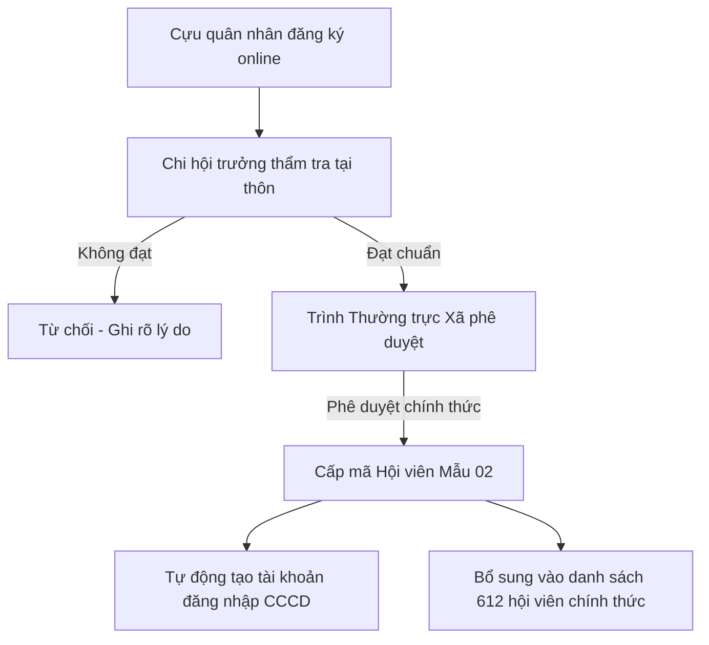

# 🎖️ TÀI LIỆU HƯỚNG DẪN SỬ DỤNG HỆ THỐNG E-CCB EA SÚP

> **Dự án:** Cổng Thông Tin Điện Tử & Quản Trị Nghiệp Vụ "E-CCB Ea Súp"  
> **Cơ quan chủ quản:** Hội Cựu Chiến Binh Xã Ea Súp — Hệ sinh thái **Ea Súp Số**  
> **Tên miền chính thức:** [https://ccb.easupso.com](https://ccb.easupso.com)  
> **Phiên bản tài liệu:** 1.0.0 (Cập nhật đầy đủ nghiệp vụ)

---

## MỤC LỤC
1. [Giới Thiệu Tổng Quan Hệ Thống](#1-giới-thiệu-tổng-quan-hệ-thống)
2. [Hướng Dẫn Dành Cho Cán Bộ Thường Trực Xã (Super Admin)](#2-hướng-dẫn-dành-cho-cán-bộ-thường-trực-xã-super-admin)
   - [2.1. Đăng nhập quản trị](#21-đăng-nhập-quản-trị)
   - [2.2. Bảng điều hành tổng quan (Bento Grid Dashboard)](#22-bảng-điều-hành-tổng-quan-bento-grid-dashboard)
   - [2.3. Quản lý hồ sơ 612 Hội viên (`/admin/members`)](#23-quản-lý-hồ-sơ-612-hội-viên-adminmembers)
   - [2.4. Quản lý "Thùng Rác" & Khôi phục hồ sơ đã xóa](#24-quản-lý-thùng-rác--khôi-phục-hồ-sơ-đã-xóa)
   - [2.5. Nhập danh sách Hội viên đồng loạt từ file Excel/CSV](#25-nhập-danh-sách-hội-viên-đồng-loạt-từ-file-excelcsv)
   - [2.6. Quản lý tài khoản & Cấp quyền đăng nhập (`/admin/permissions`)](#26-quản-lý-tài-khoản--cấp-quyền-đăng-nhập-adminpermissions)
   - [2.7. Quản lý Sổ Quỹ Hội & Vốn Vay NHCSXH (`/admin/funds`)](#27-quản-lý-sổ-quỹ-hội--vốn-vay-nhcsxh-adminfunds)
   - [2.8. Quản lý Bản tin Tuyên truyền & Duyệt bài viết (`/tin-tuc`)](#28-quản-lý-bản-tin-tuyên-truyền--duyệt-bài-viết-tin-tuc)
3. [Hướng Dẫn Dành Cho Chi Hội Trưởng (20 Thôn Buôn)](#3-hướng-dẫn-dành-cho-chi-hội-trưởng-20-thôn-buôn)
   - [3.1. Đăng nhập Chi hội trưởng](#31-đăng-nhập-chi-hội-trưởng)
   - [3.2. Không gian quản trị Chi hội (`/branch`)](#32-không-gian-quản-trị-chi-hội-branch)
   - [3.3. Quản lý 4 Nghiệp vụ Biến động Hội viên (`/branch/operations`)](#33-quản-lý-4-nghiệp-vụ-biến-động-hội-viên-branchoperations)
   - [3.4. Thẩm tra và duyệt kết nạp Hội viên mới (Cấp 1)](#34-thẩm-tra-và-duyệt-kết-nạp-hội-viên-mới-cấp-1)
4. [Hướng Dẫn Dành Cho Hội Viên Cựu Chiến Binh](#4-hướng-dẫn-dành-cho-hội-viên-cựu-chiến-binh)
   - [4.1. Đăng nhập bằng CCCD](#41-đăng-nhập-bằng-cccd)
   - [4.2. Không gian Hội viên cá nhân (`/member`)](#42-không-gian-hội-viên-cá-nhân-member)
   - [4.3. Đăng ký kết nạp Hội viên trực tuyến (`/register-member`)](#43-đăng-ký-kết-nạp-hội-viên-trực-tuyến-register-member)
5. [Quy Trình Nghiệp Vụ Mẫu](#5-quy-trình-nghiệp-vụ-mẫu)
6. [Hỏi Đáp & Xử Lý Sự Cố Thường Gặp (FAQ)](#6-hỏi-đáp--xử-lý-sự-cố-thường-gặp-faq)

---

## 1. GIỚI THIỆU TỔNG QUAN HỆ THỐNG

**E-CCB Ea Súp** là nền tảng quản trị và chuyển đổi số toàn diện công tác Hội Cựu Chiến Binh xã Ea Súp, tỉnh Đắk Lắk. Hệ thống phục vụ:
- **Thường trực Hội CCB Xã (Cán bộ xã):** Điều hành, thống kê, kiểm soát tài chính, quản lý hồ sơ và phân quyền.
- **20 Chi hội thôn, buôn:** Buôn A, Buôn B, Buôn C, Thôn Hòa Bình, Thôn Thắng Lợi, Thôn Đoàn Kết, Thôn Bình Lợi, Thôn 1 đến Thôn 13.
- **Toàn thể Hội viên CCB:** Tra cứu hồ sơ lý lịch điện tử, tham gia học tập, nắm bắt thông tin chỉ đạo của Hội.

### Bảng màu nhận diện Hallmark Quân đội:
- 🟢 **Xanh rêu (`#244023`):** Màu chủ đạo đại diện quân phục và truyền thống Bộ đội Cụ Hồ.
- 🔴 **Đỏ cờ (`#9E1A1A`):** Màu cờ Tổ quốc, điểm nhấn trang trọng, nút tác vụ quan trọng.
- 🟡 **Vàng đồng (`#B45309`):** Huy hiệu, sao vàng, viền cấp bậc, danh dự.
- 📜 **Nền kem (`#FBFBEE`):** Nền giấy công vụ trang trọng, dịu mắt cho các bác cựu chiến binh cao tuổi.

---

## 2. HƯỚNG DẪN DÀNH CHO CÁN BỘ THƯỜNG TRỰC XÃ (SUPER ADMIN)

### 2.1. Đăng nhập quản trị
1. Truy cập: `https://ccb.easupso.com/login`
2. Chọn đối tượng đăng nhập: **"🏛️ 3. Cán bộ xã (Thường trực)"** (hoặc chọn trên Header).
3. Nhập Email hoặc Username: `lehanhkt01@gmail.com` hoặc `trunghieuktkt@gmail.com`.
4. Nhập Mật khẩu quản trị và bấm **"Đăng Nhập Hệ Thống"**.

---

### 2.2. Bảng điều hành tổng quan (Bento Grid Dashboard)
Tại trang chủ quản trị (`/admin`), Cán bộ xã theo dõi các số liệu thời gian thực:
- **Tổng số hội viên chính thức:** Tính toán động từ cơ sở dữ liệu thực tế (loại trừ hồ sơ trong Thùng rác).
- **Tổng số Chi hội thôn buôn:** 20 Chi hội chuẩn hóa toàn xã.
- **Dư nợ tín dụng chính sách (NHCSXH):** Thống kê từ 20 Tổ TK&VV.
- **Tổng quỹ hội tự quản:** Số dư quỹ nội bộ thực tế từ các nguồn thu/chi.
- **Hồ sơ chờ phê duyệt:** Huy hiệu thông báo số hồ sơ mới đăng ký hoặc tin bài đang chờ xã thẩm định.

---

### 2.3. Quản lý hồ sơ 612 Hội viên (`/admin/members`)

Trang quản lý hồ sơ hội viên là trung tâm tác nghiệp chính của Cán bộ Thường trực Xã.

#### A. Thanh công cụ tác nghiệp trải dài (1 hàng ngang):
- **Ô tìm kiếm nhanh:** Gõ Họ tên, số CCCD hoặc Năm sinh.
- **Bộ lọc Thôn Buôn:** Sổ danh sách chọn lọc theo từng thôn buôn (20 thôn buôn chuẩn) hoặc "Tất cả thôn buôn".
- **Bộ lọc tình trạng:** Lọc theo hội viên chính thức, thương bệnh binh, cựu quân nhân, đảng viên...
- **Cụm nút tác vụ chuyên sâu:**
  - `📥 Nhập File Hội Viên`: Mở cửa sổ nạp đồng loạt từ Excel/CSV.
  - `📊 Xuất Excel`: Xuất toàn bộ danh sách ra file Excel 27 cột chuẩn.
  - `🗑️ Thùng Rác (X)`: Chuyển sang giao diện quản lý hồ sơ đã xóa tạm thời.
  - `➕ Thêm Hội Viên`: Lập hồ sơ hội viên mới trực tiếp trên hệ thống.

#### B. Bảng danh sách tinh gọn chuẩn hóa:
Bảng hiển thị 6 cột thông tin tối ưu:
1. **STT:** Số thứ tự liên tục (1..N).
2. **Họ và Tên:** Hiển thị trang trọng, có sao vàng `⭐ CHT` đánh dấu đối với Chi hội trưởng.
3. **Năm sinh:** Năm sinh của hội viên.
4. **Chức vụ:** Chi hội trưởng / Chi hội phó / Hội viên.
5. **Thôn / Buôn:** Đơn vị sinh hoạt thực tế.
6. **Thao tác tác nghiệp:**
   - 👁️ **Chi tiết:** Mở Modal xem toàn bộ 35 trường thông tin chi tiết.
   - ✏️ **Sửa:** Mở Modal chỉnh sửa 35 trường thông tin.
   - 📄 **Word:** Tải ngay file Word (`.docx`) Phiếu Hội Viên Mẫu 02 chuẩn theo thể thức Nghị định 30/CP.
   - ⭐ **CHT:** Nút cấp quyền Chi hội trưởng nhanh cho hội viên.

#### C. Chỉnh sửa 35 trường thông tin (Phiếu Mẫu 02) & Xóa hồ sơ:
1. Bấm nút **"Sửa"** trên dòng của hội viên.
2. Modal chỉnh sửa chia thành các nhóm thông tin:
   - **Thông tin nhân thân:** Họ tên, CCCD, ngày sinh, quê quán, dân tộc, tôn giáo, nơi ở hiện nay, SĐT.
   - **Lịch sử quân ngũ:** Ngày nhập ngũ, xuất ngũ, cấp bậc, chức vụ cao nhất, chiến trường/thời kỳ, cựu quân nhân.
   - **Sinh hoạt Hội & Đảng:** Ngày vào Hội, chức vụ, ngày vào Đảng, chi bộ sinh hoạt, huy hiệu Đảng.
   - **Trình độ & Chính sách:** Trình độ học vấn, lý luận chính trị, thương tật, chất độc da cam, thẻ BHYT.
   - **Đời sống & Kinh tế:** Tình trạng nhà ở, hộ nghèo/cận nghèo, mô hình kinh tế, dư nợ NHCSXH.
3. **Lưu thay đổi:** Bấm nút **"💾 Lưu Thay Đổi Hồ Sơ"** màu xanh rêu để cập nhật trực tiếp vào CSDL PostgreSQL.
4. **Xóa hồ sơ:** Bấm nút **"🗑️ Xóa Hồ Sơ"** màu đỏ cờ. Hệ thống sẽ yêu cầu xác nhận và chuyển an toàn hồ sơ vào **Thùng Rác** (Soft Delete), hoàn toàn không làm mất vĩnh viễn dữ liệu.

---

### 2.4. Quản lý "Thùng Rác" & Khôi phục hồ sơ đã xóa

Để đảm bảo nguyên tắc **Bảo toàn dữ liệu vĩnh viễn (Zero Data Loss)**, hệ thống áp dụng cơ chế Soft Delete:
1. Tại `/admin/members`, bấm vào nút tab **"🗑️ Thùng Rác"**.
2. Giao diện hiển thị danh sách tất cả hồ sơ đã bị xóa tạm thời, kèm thời gian xóa.
3. **Các thao tác có sẵn:**
   - **♻️ Khôi phục:** Đưa hội viên trở lại danh sách chính thức ngay lập tức.
   - **♻️ Khôi phục tất cả:** Đưa toàn bộ hồ sơ trong thùng rác về lại danh sách hoạt động.
   - **❌ Xóa hẳn (Hard Delete):** Xóa vĩnh viễn hồ sơ khỏi CSDL sau khi đã xác nhận kỹ.
   - **🧹 Dọn sạch thùng rác:** Xóa toàn bộ hồ sơ trong thùng rác khi đã hết thời hạn lưu trữ.
4. Bấm tab **"📋 Danh Sách Chính Thức"** để quay lại danh sách bình thường.

---

### 2.5. Nhập danh sách Hội viên đồng loạt từ file Excel/CSV

Tính năng nhập file tự động được thiết kế riêng cho mẫu danh sách thực tế của Hội CCB xã Ea Súp (kể cả các file có 3-4 dòng tiêu đề hành chính mở đầu):

1. Tại `/admin/members`, bấm **"📥 Nhập File Hội Viên"**.
2. **Tải file mẫu chuẩn:** Bấm nút **"📄 Tải file mẫu Excel chuẩn (Mẫu 02)"** để lấy file mẫu 27 cột chuẩn `.xlsx`.
3. **Tải file danh sách lên:** Kéo thả hoặc bấm chọn file `.xlsx`, `.xls` hoặc `.csv`.
4. **Cơ chế quét tiêu đề thông minh (Header Scanner):** Hệ thống tự động quét từ dòng 0 đến 20 để tìm đúng dòng tiêu đề thực tế (STT, Họ và tên, Năm sinh, Quê quán...).
5. **Xem trước (Preview) & Phân tích trùng lặp:**
   - Hệ thống hiển thị bảng kiểm tra trước thông tin: Tên, CCCD, Thôn buôn, Chức vụ.
   - Cảnh báo rõ các trường hợp trùng số CCCD với hội viên đã có.
   - Chọn hành vi xử lý: **"Bỏ qua trùng lặp"** hoặc **"Cập nhật đè lên hồ sơ cũ"**.
6. **Xác nhận nhập:** Bấm **"✅ Nhập Dữ Liệu Vào Hệ Thống"**. Dữ liệu được ghi thẳng vào CSDL PostgreSQL và cập nhật tức thì lên bảng danh sách.

---

### 2.6. Quản lý tài khoản & Cấp quyền đăng nhập (`/admin/permissions`)

Trang quản trị tài khoản và phân quyền gồm 3 tab độc lập:
1. **1. Cán bộ xã (SuperAdmin):** 02 tài khoản Thường trực mặc định (`lehanhkt01@gmail.com`, `trunghieuktkt@gmail.com`) được bảo vệ vĩnh viễn.
2. **2. Chi hội trưởng (20 Thôn Buôn):** Danh sách 20 Chi hội trưởng của 20 thôn buôn.
3. **3. Hội viên CCB:** Toàn bộ tài khoản của hội viên đăng nhập bằng số CCCD 12 số.

#### Các chức năng bảo mật trên từng tài khoản:
- **🔄 Đặt lại MK:** Đặt lại mật khẩu tài khoản về mật khẩu chuẩn bảo mật mặc định.
- **🔒 Khóa / 🔓 Mở:** Khóa quyền đăng nhập ngay lập tức nếu phát hiện bất thường, hoặc mở khóa trở lại.
- **🗑️ Xóa tài khoản:** Xóa tài khoản khỏi hệ thống, tự động hạ chức danh CHT về Hội viên, gỡ đại diện thôn và đưa vào danh sách đen chống tự động hồi sinh.

#### Cấp quyền / Chỉ định Chi hội trưởng mới:
1. Bấm nút **"➕ Cấp tài khoản mới"**.
2. Chọn vai trò: **"Chi Hội Trưởng"**.
3. Chọn thôn/buôn cần chỉ định (ví dụ: *Thôn Đoàn Kết*).
4. **Lựa chọn 1 trong 2 chế độ:**
   - **Chế độ 1: Chọn từ danh sách hội viên chính thức:** Sổ danh sách hội viên thực tế của thôn đó, chọn đồng chí cần bổ nhiệm -> Bấm **"Cấp Quyền Ngay"**.
   - **Chế độ 2: Nhập trực tiếp Chi hội trưởng mới:** Điền Họ tên, số CCCD 12 số, SĐT, Năm sinh. Hệ thống sẽ vừa tạo hồ sơ hội viên mới, vừa tạo tài khoản Chi hội trưởng trong CSDL.
5. Chi hội trưởng mới xuất hiện ngay trong danh sách **2. Chi hội trưởng** và có sao vàng trên bảng hội viên.

---

### 2.7. Quản lý Sổ Quỹ Hội & Vốn Vay NHCSXH (`/admin/funds`)

- **Theo dõi nguồn vốn ủy thác NHCSXH:** Quản lý số dư nguồn vốn vay chính sách của 20 Tổ Tiết kiệm & Vay vốn, theo dõi nợ quá hạn và danh sách hộ vay.
- **Sổ thu chi Quỹ hội:** Ghi nhận các khoản đóng góp quỹ tương trợ, quỹ khuyến học, thăm hỏi hội viên ốm đau, phúng viếng.
- **Thống kê minh bạch:** Tính toán tổng kết cuối kỳ phục vụ báo cáo đại hội và thanh tra của Hội cấp trên.

---

### 2.8. Quản lý Bản tin Tuyên truyền & Duyệt bài viết (`/tin-tuc`)

- **Đăng bài viết mới:** Nhập tiêu đề, tóm tắt, chọn chuyên mục (*Gương cựu chiến binh, Hoạt động phong trào, Học tập chính trị, Chuyển đổi số...*).
- **Trình soạn thảo báo chí:** Hỗ trợ định dạng văn bản chuyên nghiệp.
- **Tải album ảnh (Dropzone):** Tải tối đa 5 ảnh tư liệu chất lượng cao (dung lượng tối đa 5MB/ảnh), chọn 1 ảnh làm ảnh đại diện bìa (Thumbnail).
- **Quy trình duyệt bài 2 cấp:**
  - Tin bài do Chi hội trưởng hoặc Hội viên gửi lên sẽ ở trạng thái **Chờ duyệt (`PENDING_APPROVAL`)**.
  - Cán bộ Thường trực xã có quyền: **Duyệt xuất bản (`APPROVED`)**, **Yêu cầu chỉnh sửa** hoặc **Gỡ bài viết**.

---

### 2.9. Quản lý Bài Giảng, Phim Tư Liệu & Văn Bản Tuyên Truyền (`/admin/lectures`)

Cán bộ xã toàn quyền thêm, sửa, xóa các tài liệu bài giảng chính trị, văn bản chỉ đạo và phim tư liệu truyền thống:
1. **Truy cập:** Menu **"📚 Bài Giảng & Tư Liệu"** tại Sidebar Quản Trị hoặc đường dẫn `/admin/lectures`.
2. **Thêm mới tài liệu (`➕ Thêm Bài Giảng / Tư Liệu Mới`):**
   - **Tiêu đề:** Tên bài giảng hoặc văn bản tuyên truyền.
   - **Chuyên mục:** Lựa chọn từ danh mục chuẩn (*Bài giảng Bác Hồ, Lịch sử truyền thống, Kinh tế CCB, Nghị quyết - Chỉ thị, v.v.*) hoặc tự nhập chuyên mục mới.
   - **Thời lượng / Dung lượng:** Nhập số phút (video) hoặc số trang (tài liệu).
   - **Người trình bày / Đơn vị ban hành:** Họ tên báo cáo viên hoặc cơ quan phát hành.
   - **Liên kết Video / Bài giảng:** Dán đường dẫn YouTube hoặc link video trực tuyến.
   - **Tải lên File Văn bản Tuyên truyền:** Hỗ trợ tải lên file văn bản định dạng `.pdf`, `.doc`, `.docx`, `.xls`, `.xlsx`, `.pptx` (dung lượng tối đa 25MB). File được lưu trữ an toàn trên máy chủ.
   - **Nội dung tóm tắt:** Mô tả nội dung bài giảng/văn bản.
3. **Chỉnh sửa & Cập nhật:** Bấm **"✏️ Sửa"** trên bất kỳ tư liệu nào để cập nhật lại file đính kèm, đường dẫn video hoặc nội dung.
4. **Xóa tư liệu:** Bấm **"🗑️ Xóa"** để gỡ bỏ tư liệu. Hệ thống sẽ dọn sạch dữ liệu và đồng bộ tức thì đến toàn bộ Chi hội và Hội viên.
5. **Đồng bộ đa nền tảng:** Mọi thay đổi tại `/admin/lectures` sẽ ngay lập tức xuất hiện tại:
   - Mục **"Bài Giảng & Phim Tư Liệu"** trên PWA của 20 Chi hội trưởng (`/branch`).
   - Mục **"Chuyên Đề Học Tập & Văn Bản"** trên Cổng thông tin Hội viên (`/member`).

---

## 3. HƯỚNG DẪN DÀNH CHO CHI HỘI TRƯỞNG (20 THÔN BUÔN)

### 3.1. Đăng nhập Chi hội trưởng
1. Truy cập: `https://ccb.easupso.com/login`
2. Chọn: **"🏘️ 2. Chi hội thôn buôn"**.
3. Tên đăng nhập: Nhập **Số điện thoại** hoặc **Số CCCD 12 số** của Chi hội trưởng.
4. Mật khẩu: Mật khẩu mặc định hoặc mật khẩu đã đổi.
5. Bấm **"Đăng Nhập Chi Hội"**.

---

### 3.2. Không gian quản trị Chi hội (`/branch`)

Giao diện PWA chuyên biệt tối ưu cho điện thoại thông minh:
- **Thống kê nhanh:** Số lượng hội viên của thôn, số đảng viên, số gia đình chính sách, quỹ hội thôn.
- **Danh sách hội viên trong thôn:** Xem danh sách đầy đủ các bác trong chi hội mình quản lý.
- **Điểm danh sinh hoạt:** Tích chọn điểm danh các buổi sinh hoạt chi hội định kỳ ngày 19 hàng tháng.
- **Thu nộp hội phí:** Ghi nhận đóng góp hội phí và quỹ tương trợ từng hội viên theo năm.

---

### 3.3. Quản lý 4 Nghiệp vụ Biến động Hội viên (`/branch/operations`)

Tại menu Chi hội, chọn thẻ **"📑 Quản lý 4 nghiệp vụ biến động"**:
1. Bấm **"➕ Thực hiện nghiệp vụ mới"**.
2. **Chọn loại nghiệp vụ:**
   - 📥 **Chuyển đến:** Tiếp nhận hội viên từ xã khác/tỉnh khác chuyển về sinh hoạt tại thôn.
   - 🚚 **Chuyển đi:** Cấp giấy giới thiệu cho hội viên chuyển nơi cư trú đến địa phương khác.
   - ⛔ **Xóa tên:** Lập hồ sơ xóa tên hội viên vi phạm điều lệ hoặc không sinh hoạt liên tục.
   - 🕊️ **Báo tử:** Lập hồ sơ báo tử khi hội viên từ trần, ghi nhận nơi an táng và hỗ trợ tang lễ.
3. **Nhập thông tin chi tiết:** Chọn hội viên, ngày diễn ra sự kiện, số quyết định/giấy giới thiệu, lý do cụ thể, nơi chuyển đến/nơi an táng.
4. **Đính kèm văn bản:** Chụp ảnh hoặc tải file PDF quyết định, trích lục khai tử hoặc giấy chuyển sinh hoạt.
5. **Lưu hồ sơ:** Bấm **"Xác Nhận Lưu Nghiệp Vụ"**. Hồ sơ biến động được lưu trữ và đồng bộ tức thì lên hệ thống xã.
6. **Xóa hồ sơ:** Nếu lập nhầm, Chi hội trưởng có thể bấm biểu tượng **🗑️** trên thẻ nghiệp vụ để xóa bỏ.

---

### 3.4. Thẩm tra và duyệt kết nạp Hội viên mới (Cấp 1)

Khi có cựu quân nhân trong thôn nộp đơn xin vào Hội trực tuyến:
1. Chi hội trưởng nhận thông báo chuông 🔔 trên màn hình.
2. Mở danh sách hồ sơ đăng ký mới của thôn mình.
3. Kiểm tra điều kiện xuất ngũ, phẩm chất đạo đức tại địa phương.
4. Bấm **"Đạt tiêu chuẩn - Trình Xã duyệt"** để chuyển hồ sơ lên Thường trực Hội CCB Xã phê chuẩn bước 2.

---

## 4. HƯỚNG DẪN DÀNH CHO HỘI VIÊN CỰU CHIẾN BINH

### 4.1. Đăng nhập bằng CCCD
1. Truy cập: `https://ccb.easupso.com/login`
2. Mặc định chọn: **"🎖️ 1. Hội viên CCB"**.
3. Tên đăng nhập: Nhập **Số Căn cước công dân (CCCD) 12 số**.
4. Mật khẩu: Mật khẩu mặc định hoặc mật khẩu đã đổi.
5. Bấm **"Đăng Nhập Hội Viên"**.

---

### 4.2. Không gian Hội viên cá nhân (`/member`)

- **Xem Lý lịch điện tử:** Xem toàn bộ 35 mục thông tin lý lịch cá nhân theo Phiếu Mẫu 02 (quân hàm, đơn vị chiến đấu, huân huy chương, ngày vào Hội...).
- **Đổi mật khẩu:** Chủ động đổi mật khẩu riêng để bảo vệ thông tin cá nhân.
- **Sổ quỹ cá nhân:** Xem lịch sử đóng hội phí và tiền ủng hộ các quỹ nghĩa tình đồng đội.
- **Tư liệu học tập:** Đọc các bài giảng chính trị, tài liệu truyền thống lịch sử vẻ vang của Hội Cựu Chiến Binh Việt Nam và lực lượng vũ trang Ea Súp.

---

### 4.3. Đăng ký kết nạp Hội viên trực tuyến (`/register-member`)

Dành cho Cựu quân nhân, quân nhân hoàn thành nghĩa vụ quân sự trở về địa phương có nguyện vọng gia nhập Hội:
1. Truy cập đường dẫn: `https://ccb.easupso.com/register-member`
2. Điền đầy đủ thông tin: Họ tên, số CCCD, ngày sinh, thôn buôn sinh hoạt, thời gian nhập ngũ, xuất ngũ, cấp bậc, đơn vị phục vụ.
3. Bấm **"Gửi Hồ Sơ Đăng Ký Gia Nhập Hội"**.
4. Hồ sơ sẽ tự động chuyển về Chi hội trưởng thôn buôn tương ứng để thẩm tra bước 1.

---

## 5. QUY TRÌNH NGHIỆP VỤ MẪU

---

## 6. HỎI ĐÁP & XỬ LÝ SỰ CỐ THƯỜNG GẶP (FAQ)

### ❓ 1. Tôi bấm xóa nhầm một hội viên thì lấy lại bằng cách nào?
> **Trả lời:** Cán bộ xã chỉ cần vào trang `/admin/members`, bấm vào nút **"🗑️ Thùng Rác"** trên thanh công cụ. Tìm tên hội viên và bấm nút **"♻️ Khôi Phục"**. Hồ sơ sẽ được phục hồi nguyên vẹn 100% cùng toàn bộ 35 trường thông tin.

### ❓ 2. Một thôn có thể có 2 Chi hội trưởng cùng hoạt động không?
> **Trả lời:** Hoàn toàn được. Hệ thống cho phép một chi hội có nhiều đồng chí cùng đảm nhiệm chức danh Chi hội trưởng (ví dụ: Chi hội trưởng đương nhiệm và Chi hội phó phụ trách hoặc bàn giao nhiệm kỳ mới) mà không bị ghi đè hay mất quyền của nhau.

### ❓ 3. Hội viên quên mật khẩu thì xử lý thế nào?
> **Trả lời:** Cán bộ xã vào `/admin/permissions`, tìm tên hoặc số CCCD của hội viên đó, bấm nút **"🔄 Đặt lại MK"**. Mật khẩu sẽ được hoàn về mật khẩu mặc định của hệ thống để hội viên đăng nhập lại.

### ❓ 4. Xuất file Word Phiếu Mẫu 02 có đúng chuẩn thể thức văn bản không?
> **Trả lời:** File Word `.docx` xuất ra từ nút **"📄 Word"** tuân thủ tuyệt đối quy định trình bày thể thức văn bản hành chính theo **Nghị định 30/2020/NĐ-CP** của Chính phủ, có sẵn quốc hiệu, tiêu ngữ, bảng biểu và chỗ ký tên xác nhận của Thường trực Hội CCB xã.

### ❓ 5. Tôi muốn liên hệ kỹ thuật thì gặp ai?
> **Cán bộ phụ trách công nghệ thông tin:**
> - Đồng chí **Lê Hạnh** (Thường trực Hội CCB Xã) — Email: `lehanhkt01@gmail.com`
> - Đồng chí **Đặng Trung Hiếu** (Chủ tịch Hội CCB Xã) — Email: `trunghieuktkt@gmail.com`
> - Đơn vị bảo trợ công nghệ: Ban Chuyển đổi số **Ea Súp Số** (`easupso.com`).

---
*Tài liệu được ban hành và cập nhật phục vụ công tác chuyển đổi số Hội Cựu Chiến Binh Xã Ea Súp.*
